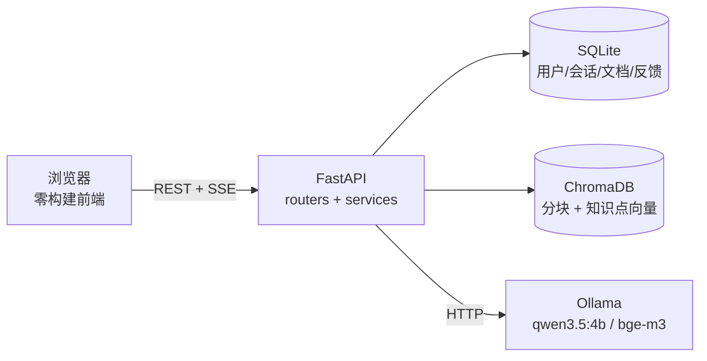

# 智答系统（基于 RAG 的课程问答助手）

面向高校课程答疑的全栈应用：以课程资料为唯一知识来源，由大模型生成回答并给出引用出处；
知识库覆盖不到时**拒答并记录反馈**，教师补充资料后再闭环回复。

- **技术栈**：FastAPI + SQLAlchemy + SQLite（元数据）+ ChromaDB（向量）+ 原生 HTML/CSS/JS（零构建）
- **模型**：默认 Ollama `qwen3.5:4b`（对话）+ `bge-m3`（向量），可切任意 OpenAI 兼容接口
- **角色**：学生（提问、自建知识库、看自己的反馈）/ 管理员（内容管理、用户管理、数据概览）
- **规模**：8 个路由模块、47 个接口、9 张业务表、11 个前端视图模块；启动 10–16 秒

## 亮点

| 亮点 | 说明 |
| --- | --- |
| **只答资料里有的** | 三道拒答防线：距离门控（L2 > 0.85）→ 模型标记「未收录」→ 可选的可答性判定。宁可拒答，不编造 |
| **未命中反馈闭环** | 拒答即记录（同人同问题去重）→ 管理员按问题聚类（余弦 0.78 / 二元组 0.55）→ 补资料 → 一键重生成 → 学生端未读提醒 |
| **可见性隔离** | 学生只检索「公共库 + 自己的库」；**看得见 ≠ 写得进**，公共库对非创建者只读，避免污染全班回答 |
| **误删可恢复** | 删除知识库先落快照与源文件，30 天内一键恢复并重新向量化，启动时清理过期快照 |
| **单机也扛并发** | 同时最多 3 路生成 + 10 秒心跳保活 + 120 秒排队上限；同会话新提问顶掉旧请求，不产生两条答案 |

## 快速开始

```bash
# 1. 准备模型（需先装 Ollama）
ollama pull qwen3.5:4b     # 对话模型
ollama pull bge-m3         # 向量模型

# 2. 装依赖
python -m venv venv && venv\Scripts\activate    # macOS/Linux: source venv/bin/activate
pip install -r requirements.txt

# 3. 起服务（自动打开 http://127.0.0.1:8000）
python run.py
```

- 环境要求：Windows / macOS / Linux，Python 3.10+
- 首次启动约 **10–16 秒**（模型由 Ollama 侧加载，首次回答另需 20–30 秒预热）
- 默认管理员：**`23040107` / `111111`**，登录后请立即在「个人中心」改密码
- 想用云端模型：`.env` 里 `LLM_PROVIDER=openai` 并填 `OPENAI_API_KEY`（支持 DeepSeek 等兼容接口）
- 也可以双击 `start.bat`，或 `python run.py --no-browser` / `--port 9000`

> ⚠️ 别额外安装 `sentence-transformers`（连带 `transformers`/`torch`）：`langchain_text_splitters`
> 的包初始化会无条件导入它，装了之后每次启动要多等 20–80 秒。本项目不需要它，向量化走 Ollama。

## 功能一览

| 学生 | 管理员 |
| --- | --- |
| 首页：四张统计卡 + 功能入口 + 我的反馈（一屏放下） | 数据概览：四张卡 + 近 7 日趋势 + 文档占比环形图 + 最近未命中 |
| 智能问答：流式回答、引用溯源、停止生成、会话重命名/删除/搜索 | 知识库与文档：两个 Tab 的表格、弹窗内可传文档、查看内容、重新解析 |
| 对话历史：服务端分页 + 标题搜索 + 详情 | 问题反馈：全部/处理中/已解决/**按问题聚类**，一键生成回答 |
| 我的反馈：待处理/已解决、新回答高亮、点开即读 | 回收站：快照列表、剩余天数、恢复/彻底删除 |
| 知识库：卡片总览（每页 12）+ 新建 + 知识库内维护 | 对话历史：全部会话、按标题/提问者搜索、删除 |
| 我的文档：上传（选知识库）、搜索分页、查看、重新解析 | 用户管理：搜索、新增、改角色、重置密码、删除 |
| 个人中心：资料、头像、改密码 | 智能问答：同款界面用于自测 |

完整操作说明（Enter 发送、长按退出、分页规则等）见 [docs/04-使用手册.md](docs/04-使用手册.md)。

## 系统架构



问答链路：问题 → 按可见范围向量检索 Top-5 → 距离门控 → 组装提示词（规则 + 资料 + 最近 6 轮）
→ 并发闸门排队 → 流式生成 → 落库（回答 + 引用 JSON）。
模块划分、RAG 参数、ER 图、接口清单见 [docs/02-系统设计.md](docs/02-系统设计.md)。

## 目录结构

```
rag-course-assistant/
├── run.py                     # 启动入口（--reload / --port / --no-browser；端口占用自动跳过）
├── pyproject.toml             # ruff（120 列 E/F/I）+ pytest 配置
├── requirements.txt / .env.example / start.bat
├── backend/
│   ├── main.py                # 路由装配、静态托管（no-cache）、启动迁移
│   ├── config.py              # 集中配置（.env、JWT_SECRET 校验）
│   ├── database.py            # SQLite 引擎、外键/WAL、增量迁移
│   ├── models.py              # 9 张业务表
│   ├── schemas.py             # 请求/响应模型
│   ├── security.py / deps.py  # PBKDF2 + JWT / 当前用户与角色
│   ├── seed.py + seed_data.py # 幂等种子写入 / 演示数据（纯数据）
│   ├── routers/               # auth chat knowledge documents users stats unanswered recycle
│   ├── services/              # llm embedding parser chunker vector_store
│   │                          # rag_service（检索+生成）rag_prompts（提示词/词表）
│   │                          # kb_scope（可见性）recycle（快照）like（搜索转义）
│   └── static/                # 3 个页面 + css/ + js/（views/ 每页一个模块）
├── tests/                     # 21 个 pytest 用例 + 2 个 node 前端回归
├── docs/                      # 论文素材与手册（见下表）
├── data/                      # 运行时生成，不入库：app.db / chroma/ / uploads/ / trash/
└── .tools/                    # 一次性运维脚本（重建向量、标定阈值、造演示数据）
```

## 配置

全部来自 `.env`（模板 `.env.example`），**改完重启生效**；除 `JWT_SECRET` 外都有默认值。

| 键 | 默认值 | 说明 |
| --- | --- | --- |
| `HOST` / `PORT` | `127.0.0.1` / `8000` | `HOST` 非回环且管理员仍是默认密码时**拒绝启动** |
| `JWT_SECRET` | 无（必填） | 少于 32 位或仍是模板占位值会拒绝启动 |
| `LLM_PROVIDER` | `ollama` | `ollama` / `openai`；`EMBEDDING_PROVIDER` 可单独指定向量来源 |
| `OLLAMA_LLM_MODEL` | `qwen3.5:4b` | 对话模型（换更小模型回答更快） |
| `OLLAMA_EMBED_MODEL` | `bge-m3` | 向量模型（**换了必须重新标定阈值并重建向量**） |
| `TOP_K` | `5` | 检索条数 |
| `UNMATCHED_DISTANCE` | `0.85` | 拒答阈值（L2 距离），实测空档 0.78–0.91 |
| `CHUNK_SIZE` / `CHUNK_OVERLAP` | `800` / `120` | 分块长度与重叠 |
| `LLM_TIMEOUT` | `180` | 单次回答超时（秒），不含排队时间 |
| `JWT_EXPIRE_HOURS` / `UTC_OFFSET_HOURS` | `72` / `8` | 令牌有效期 / 统计时区 |

其余写死在代码里的上限（限流次数、并发路数、上传大小、回收站天数等）与所在文件，见
[docs/04-使用手册.md](docs/04-使用手册.md)。

## 质量与回归

```bash
python -m ruff check .     # 静态检查，当前 0 问题
python -m pytest           # 23 个用例（含 2 个 node 前端回归），实测约 13 秒
```

- 后端单元用例覆盖可见性、拒答判定、限流清理、分页搜索、并发闸门、提示词装配等
- 前端纯函数回归：[`tests/frontend_pagination.mjs`](tests/frontend_pagination.mjs)（分页条）、
  [`tests/frontend_markdown.mjs`](tests/frontend_markdown.mjs)（转义与危险链接白名单，21 条断言）
- 端到端验收记录与性能实测见 [docs/03-测试与验收.md](docs/03-测试与验收.md)

## 文档索引

| 文档 | 用途 | 适合谁看 |
| --- | --- | --- |
| [docs/01-需求分析.md](docs/01-需求分析.md) | 建设目标、角色权限、功能需求、**前端需求分析**、非功能需求、用例 | 写论文的需求分析章 |
| [docs/02-系统设计.md](docs/02-系统设计.md) | 架构、技术选型、模块设计、RAG 参数与拒答设计、ER 图与表结构、47 接口、**前端结构设计** | 写论文的设计章 |
| [docs/03-测试与验收.md](docs/03-测试与验收.md) | 测试策略、用例清单、端到端记录、性能实测、安全测试、已知限制 | 写论文的测试章 / 答辩演示 |
| [docs/04-使用手册.md](docs/04-使用手册.md) | 逐页操作说明、常见问题、运维脚本 | 自己用 / 给同学部署 |
| [docs/05-开发记录.md](docs/05-开发记录.md) | 32 条踩坑与决策理由 | 答辩问答 / 接手维护 |

接口交互文档：启动后访问 **http://127.0.0.1:8000/docs**（FastAPI 自动生成）。

## 常见问题

**页面提示「127.0.0.1 拒绝了连接请求」** — 服务还没起完（10–16 秒），等日志出现监听信息再刷新；
一直如此就看终端报错，常见原因是 `JWT_SECRET` 没配。

**问答报「模型服务还没准备好」** — `ollama list` 确认有 `qwen3.5:4b` 和 `bge-m3`，没有就 `ollama pull`。
若 `ollama list` 是空的，检查 Ollama 桌面端的「模型位置」是不是指向了空目录。

**上传 PDF 解析失败** — 多为扫描件（没有文本层），需先 OCR，或改用 TXT / Markdown；
文件本身没问题就点「重新解析」，不用重传。

**端口被占用** — `run.py` 检测到会直接跳过启动（防重复起进程）；换端口用 `--port 9000` 或改 `.env`。

**多人同时提问，后面的人报「当前提问人数较多」** — 本机模型一次只吐一路 token，服务端限 3 路
生成，排队最多 120 秒；想更快就换小模型或云端接口。

**把 `HOST` 改成 `0.0.0.0` 启动直接退出** — 故意的：管理员还是默认密码时不允许对局域网开放。
按报错三步走：改回 `127.0.0.1` → 登录改密码 → 再放开 `HOST`。

**误删了知识库** — 管理员 → 回收站，30 天内可恢复（只收「整个库被删」的快照，单独删知识点不落快照）。

**回答总被拒答 / 检索结果不对** — 停服务后跑 `python .tools/rebuild_vectors.py` 重建向量，
再用 `kb_probe.py` 看距离分布是否仍在 0.85 两侧；换过向量模型就必须重新标定阈值。

> 其余 16 条常见问题（聚类阈值、会话记录过多、超时、并发细节等）见
> [docs/04-使用手册.md](docs/04-使用手册.md)。

## 已知限制

- **只能单进程运行**：会话「新提问顶掉旧请求」依赖进程内状态，`--workers N` 会退化成两条答案
- **拒答阈值与向量模型绑定**：换模型要重新标定 `UNMATCHED_DISTANCE`，否则批量误拒
- **不支持扫描件**：无 OCR，扫描版 PDF 取不到文字
- **端到端回归未进 CI**：靠 `.tools/kb_e2e.py` 与一次性脚本手工跑
