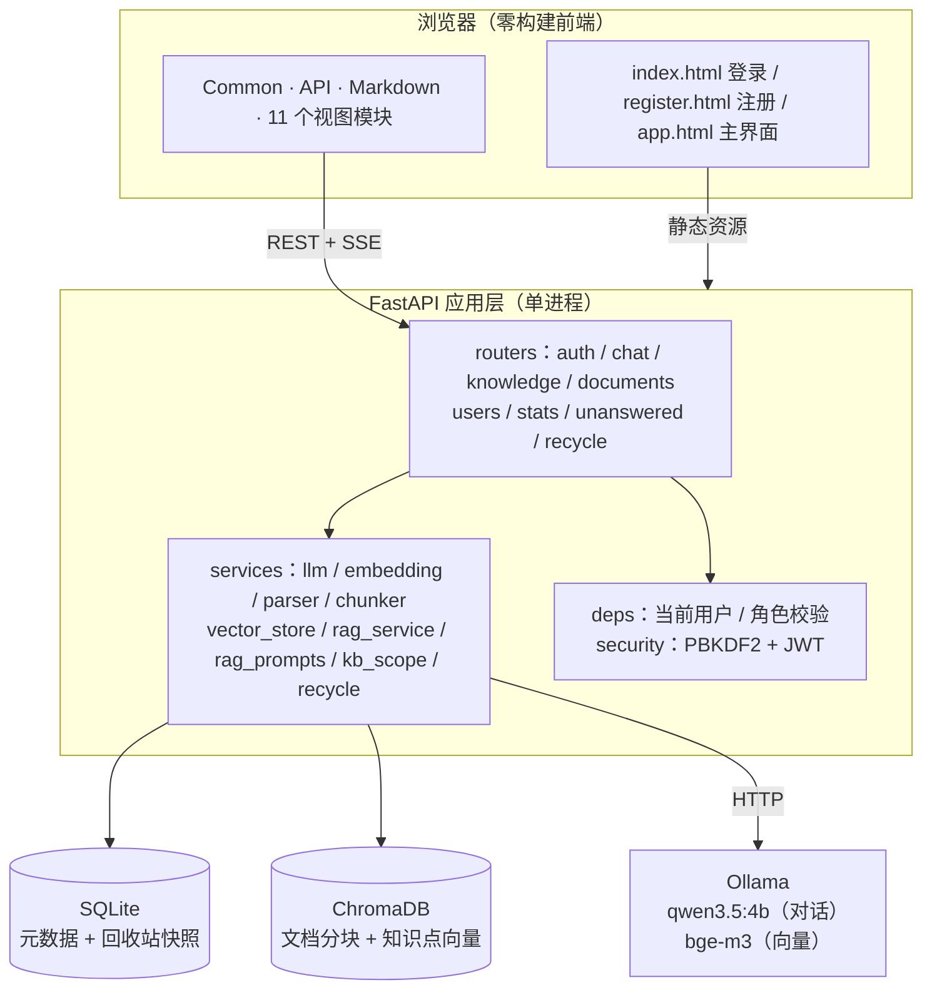
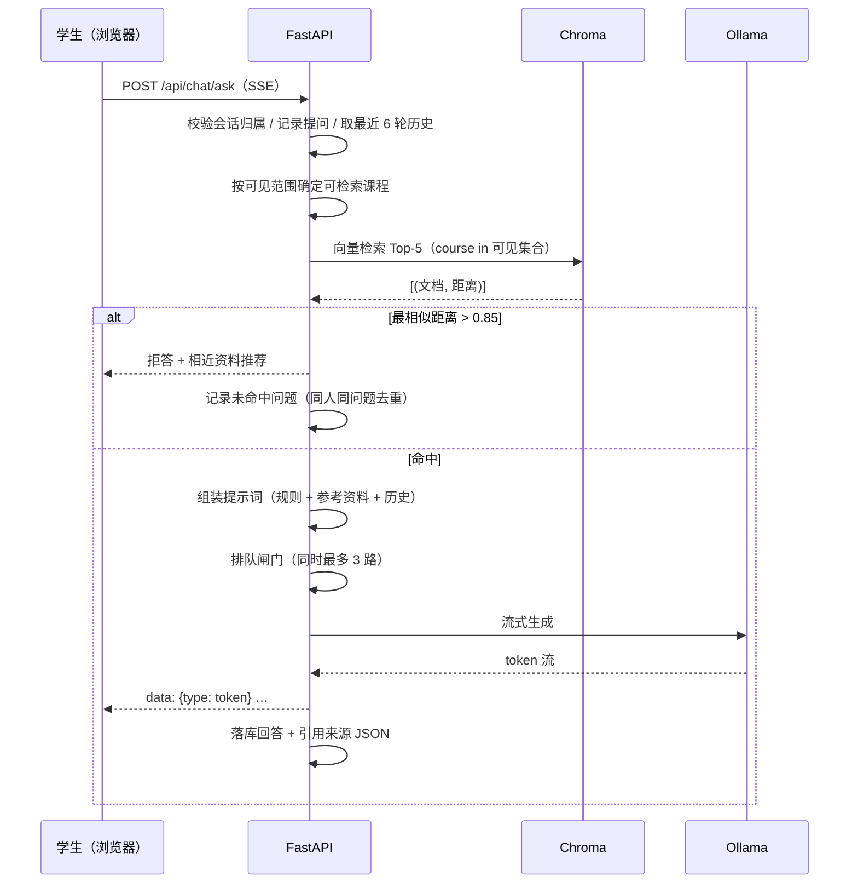
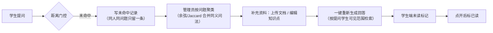
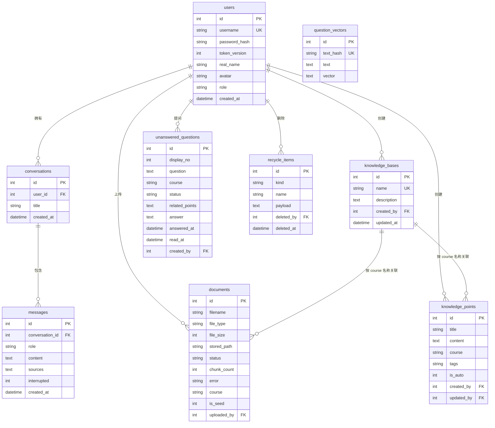

# 系统设计

> 本文档是毕业论文「系统设计」一章的素材，覆盖概要设计与详细设计。
> 图中的 mermaid 代码可直接在 Typora / VS Code / GitHub 渲染，论文里请按需重绘为 Visio 或
> draw.io 图。

## 1. 总体架构

系统采用"前后端分离部署、单体后端"的经典三层结构：浏览器只加载静态资源，业务能力全部通过
REST + SSE 接口提供；数据层由关系库（元数据）、向量库（语义检索）和外部大模型服务组成。



**分层职责**

| 层 | 职责 | 不允许做的事 |
| --- | --- | --- |
| 视图层（`backend/static`） | 渲染、交互、请求封装 | 不做权限判断、不拼业务规则 |
| 路由层（`routers`） | 参数校验、鉴权、组装响应、SSE 推送 | 不写检索算法、不直接操作向量库 |
| 服务层（`services`） | 检索、提示词、分块、向量化、回收站、可见性 | 不关心 HTTP 状态码 |
| 数据层 | SQLite（结构化）+ Chroma（语义） | — |

## 2. 技术选型

| 技术 | 用途 | 选型理由 |
| --- | --- | --- |
| FastAPI | Web 框架 | 原生 async + SSE 流式；自动生成 OpenAPI 文档（答辩可直接展示 `/docs`） |
| SQLAlchemy 2.x | ORM | 类型化 `Mapped` 声明；迁移用增量 `ALTER TABLE` 兜底 |
| SQLite（WAL） | 元数据库 | 单机零部署；WAL + `busy_timeout` 让读不阻塞写 |
| ChromaDB | 向量库 | 嵌入式持久化，无需单独服务；支持 metadata 过滤（按课程隔离） |
| LangChain（core/chroma/ollama） | 模型与检索胶水 | 统一 Ollama 与 OpenAI 兼容接口；切换模型只改 `.env` |
| Ollama | 本地推理 | 数据不出口；4B 模型 16G 内存可跑 |
| PyJWT + hashlib | 认证 | 标准库 PBKDF2 免 bcrypt 编译依赖 |
| 原生 HTML/CSS/JS | 前端 | 零构建、断网可用、答辩现场改一行即可演示 |

## 3. 后端模块设计

### 3.1 路由模块

| 模块 | 接口数 | 职责 |
| --- | --- | --- |
| `auth.py` | 6 | 注册、登录、当前用户、改密、改资料、头像上传 |
| `chat.py` | 11 | 会话 CRUD、消息列表、SSE 问答、学生反馈（我的）、管理员会话视图 |
| `knowledge.py` | 9 | 知识库与知识点增删改查（分页 + 搜索 + 可见性） |
| `documents.py` | 5 | 上传（后台解析）、列表、详情（分块预览）、重新解析、删除 |
| `users.py` | 5 | 管理员用户管理（列表/选项/新增/修改/删除） |
| `stats.py` | 2 | 学生个人统计、管理员全局统计（含 7 日趋势） |
| `unanswered.py` | 6 | 未命中问题列表、聚类、统计、重新生成回答、状态、删除 |
| `recycle.py` | 3 | 回收站列表、恢复、彻底删除 |

### 3.2 服务模块

| 模块 | 职责 | 关键点 |
| --- | --- | --- |
| `llm_service.py` | 按配置返回 Chat 模型 | 显式关闭 qwen3.5 的思考（`reasoning=False`），否则正文被思考过程挤空 |
| `embedding_service.py` | 返回嵌入模型 | 与对话模型可用不同来源（`EMBEDDING_PROVIDER`） |
| `document_parser.py` | PDF/TXT/MD/CSV 取文本 | 只取文本，不做 OCR |
| `chunker.py` | 递归字符分块，兼顾中文标点 | 分隔符含 `。！？；`；**延迟导入**分词器，避免启动时拉起 transformers |
| `vector_store.py` | 向量增删查 | 文档分块与知识点同集合；检索按 `course` 元数据过滤；结果按来源去重 |
| `rag_prompts.py` | 提示词与判定词表 | 纯常量 + 纯函数，调提示词不用翻生成逻辑 |
| `rag_service.py` | 检索 → 门控 → 生成 → 拒答 | 并发闸门、超时、序号顶替 |
| `kb_scope.py` | 可见性与写权限 | 学生"看得见 ≠ 写得进"：公共库只读 |
| `recycle.py` | 删除快照与过期清理 | 源文件移入 `data/trash/<id>/`，恢复时搬回 |

依赖方向单向：`routers → services → (models, config, database)`，服务之间不互相调用成环。

## 4. RAG 核心设计

### 4.1 问答流程



### 4.2 关键参数

| 参数 | 默认值 | 作用 | 调大/调小的效果 |
| --- | --- | --- | --- |
| `TOP_K` | 5 | 检索条数 | 大 → 召回全但噪声多、提示词变长 |
| `UNMATCHED_DISTANCE` | 0.85 | 拒答阈值（L2 距离） | 小 → 更严格，更多拒答 |
| `CHUNK_SIZE` / `CHUNK_OVERLAP` | 800 / 120 | 分块长度与重叠 | 大 → 上下文完整但检索粒度粗 |
| `HISTORY_LIMIT` / `HISTORY_CHAR_BUDGET` | 6 轮 / 6000 字 | 多轮上下文 | 大 → 追问连贯但可能挤爆 8K 窗口 |
| `ANSWERABILITY_CHECK` | false | 命中后再让模型判"资料能否直接回答" | 开 → 更少幻觉，每次多一次模型调用 |
| `LLM_TIMEOUT` | 180 s | 单轮生成上限 | — |
| 会话聚类阈值 | 余弦 0.78 / Jaccard 0.55 | 同义问题合并 | 小 → 合并更激进 |

> 阈值不是拍脑袋：`.env` 注释记录了实测分布——库里有答案 0.46–0.78，库里没有但话题沾边
> 0.91–1.05，完全无关 1.19–1.21，0.85 落在空档。换向量模型后必须重新标定。

### 4.3 三道拒答防线

| 防线 | 判据 | 防的问题 |
| --- | --- | --- |
| ① 距离门控 | 最相似距离 > 0.85 | 知识库压根没这个话题 |
| ② 模型标记 | 回答前 40 字出现"【知识库未收录】"等特征短语 | 模型自己判断资料不支撑 |
| ③ 可答性判定（可选） | 窄任务模型只回"有/没有" | 资料看似相关、实际讲的不是这个点（资料讲二叉树、学生问红黑树） |

拒答时不只丢一句"不知道"：推荐 3 条相近资料标题引导换问法，并写入未命中反馈。

### 4.4 反馈闭环



闭环的价值：教师的每一次补资料都有明确来源（学生真实问不到的问题），而不是凭感觉猜。

### 4.5 并发与失败设计

单机 4B 模型一次只能吐一路 token，因此：

| 机制 | 实现 | 解决的问题 |
| --- | --- | --- |
| 并发闸门 | 每事件循环一个 `Semaphore(3)` | 无限并发时所有请求一起撞 180 s 超时 |
| 排队心跳 | 每 10 s 发 `ping` 事件 | 前端空闲超时会把排队中的请求误杀 |
| 排队上限 | 120 s | 明确回"当前提问人数较多"，不让用户干等 |
| 序号顶替 | 会话级 `_gen_seq` | 同一会话连发两次，旧回答不落库、不占模型 |
| 失败不落库 | 超时/报错/空回答 → 占位提示 | 避免把半截回答当正式答案喂给下一轮历史 |
| 单进程约束 | `run.py` 固定单 worker | 序号是进程内状态，多 worker 会退化成两条答案 |

## 5. 数据库设计

### 5.1 ER 图



### 5.2 表清单与设计要点

| 表 | 行数（示例库） | 设计要点 |
| --- | --- | --- |
| `users` | 50 | `username` 唯一；`role` 建索引；`token_version` 实现改密即踢下线 |
| `conversations` | 210 | `user_id` 外键 CASCADE，删用户即删会话；两个遗留列保留只为不破坏老库 |
| `messages` | 981 | `sources` 存引用 JSON；`interrupted` 区分完整回答与中断半截 |
| `knowledge_bases` | 12 | 按课程组织；知识点与文档用 `course` 名称关联（不设外键，改名需同步） |
| `knowledge_points` | 162 | `is_auto` 标记"文档自动生成"，重建向量时跳过，避免与分块重复 |
| `documents` | 53 | `status` 三态（processing/ready/failed）；`is_seed` 标记演示数据 |
| `unanswered_questions` | 85 | `display_no` 是展示编号，删除后重排，不依赖主键 |
| `question_vectors` | 40 | 问题向量缓存，`text_hash` 唯一，聚类时复用 |
| `recycle_items` | 2 | `payload` 存库信息+知识点正文 JSON，源文件在 `data/trash/<id>/` |

> 说明：示例库中还有一张 `message_feedback`（0 行），是早期"回答点赞"功能遗留的表，代码
> 已不再读写。保留不影响运行，如需交付干净库可在确认后删除。

**外键与约束**：SQLite 默认不校验外键，连接时显式 `PRAGMA foreign_keys=ON`；
`journal_mode=WAL` + `busy_timeout=5000` 让读写并发不互相阻塞。

**增量迁移**：`init_db()` 每次启动按 `PRAGMA table_info` 比对补列（头像、token_version、
回收站相关字段、`is_auto`、`display_no` 等），避免重新建库丢数据。

## 6. 接口设计

### 6.1 统一约定

| 项 | 约定 |
| --- | --- |
| 鉴权 | `Authorization: Bearer <JWT>`；角色接口再用 `require_role` 校验 |
| 分页 | 查询参数 `limit` / `offset`，响应含 `total` 与 `items` |
| 搜索 | 统一 `q` 参数，服务端 `LIKE` 并转义 `%_`（`services/like.py`） |
| 错误 | HTTP 状态码 + `{"detail": "中文说明"}`；401 令牌失效、403 越权、404 不存在 |
| 流式 | `POST /api/chat/ask` 返回 `text/event-stream`，事件见 6.3 |

### 6.2 接口清单（47 个）

**auth（6）**

| 方法 | 路径 | 说明 |
| --- | --- | --- |
| POST | `/api/auth/register` | 注册（学生） |
| POST | `/api/auth/login` | 登录 |
| GET | `/api/auth/me` | 当前用户信息 |
| POST | `/api/auth/change-password` | 修改密码 |
| PUT | `/api/auth/profile` | 更新个人资料 |
| POST | `/api/auth/avatar` | 上传头像 |

**chat（11）**

| 方法 | 路径 | 说明 |
| --- | --- | --- |
| POST | `/api/chat/sessions` | 新建会话 |
| GET | `/api/chat/unanswered/mine` | 我的问题反馈（学生，分页） |
| POST | `/api/chat/unanswered/{qid}/read` | 标记我的反馈已读（学生） |
| GET | `/api/chat/sessions` | 会话列表（分页 + 标题搜索） |
| PATCH | `/api/chat/sessions/{conv_id}` | 重命名会话 |
| DELETE | `/api/chat/sessions/{conv_id}` | 删除会话 |
| GET | `/api/chat/sessions/{conv_id}/messages` | 会话消息 |
| GET | `/api/chat/admin/conversations` | 全部会话（管理员，分页） |
| GET | `/api/chat/admin/conversations/{conv_id}/messages` | 会话消息（管理员） |
| DELETE | `/api/chat/admin/conversations/{conv_id}` | 删除会话（管理员） |
| POST | `/api/chat/ask` | 智能问答（SSE 流式） |

**knowledge（9）**

| 方法 | 路径 | 说明 |
| --- | --- | --- |
| GET | `/api/knowledge/bases/page` | 知识库列表（分页 + 服务端搜索） |
| GET | `/api/knowledge/bases` | 知识库列表（含统计） |
| POST | `/api/knowledge/bases` | 新增知识库 |
| PUT | `/api/knowledge/bases/{base_id}` | 更新知识库 |
| DELETE | `/api/knowledge/bases/{base_id}` | 删除知识库（进回收站） |
| GET | `/api/knowledge/points/page` | 知识点列表（分页 + 搜索） |
| POST | `/api/knowledge/points` | 新增知识点 |
| PUT | `/api/knowledge/points/{point_id}` | 更新知识点 |
| DELETE | `/api/knowledge/points/{point_id}` | 删除知识点 |

**documents（5）**

| 方法 | 路径 | 说明 |
| --- | --- | --- |
| POST | `/api/documents/upload` | 上传课程文档（后台解析） |
| GET | `/api/documents` | 文档列表（分页 + 搜索） |
| POST | `/api/documents/{doc_id}/reparse` | 重新解析失败的文档 |
| GET | `/api/documents/{doc_id}` | 文档详情（含分块预览） |
| DELETE | `/api/documents/{doc_id}` | 删除文档（连同向量） |

**users（5）**

| 方法 | 路径 | 说明 |
| --- | --- | --- |
| GET | `/api/admin/users` | 用户列表（管理员，分页） |
| GET | `/api/admin/users/options` | 用户下拉选项 |
| POST | `/api/admin/users` | 新增用户 |
| PATCH | `/api/admin/users/{user_id}` | 修改用户（角色/重置密码） |
| DELETE | `/api/admin/users/{user_id}` | 删除用户（级联清理） |

**stats（2）**

| 方法 | 路径 | 说明 |
| --- | --- | --- |
| GET | `/api/stats/me` | 个人统计（工作台） |
| GET | `/api/stats/admin/stats` | 系统统计（管理员） |

**unanswered（6）**

| 方法 | 路径 | 说明 |
| --- | --- | --- |
| GET | `/api/admin/unanswered` | 未命中问题列表 |
| GET | `/api/admin/unanswered/clusters` | 未命中问题聚类 |
| GET | `/api/admin/unanswered/stats` | 未命中问题统计 |
| POST | `/api/admin/unanswered/{qid}/regenerate` | 补资料后重新生成回答 |
| PATCH | `/api/admin/unanswered/{qid}` | 标记状态 |
| DELETE | `/api/admin/unanswered/{qid}` | 删除记录 |

**recycle（3）**

| 方法 | 路径 | 说明 |
| --- | --- | --- |
| GET | `/api/admin/recycle` | 回收站列表 |
| POST | `/api/admin/recycle/{item_id}/restore` | 恢复 |
| DELETE | `/api/admin/recycle/{item_id}` | 彻底删除 |

> 另有两个非业务接口：`GET /api/health`（健康检查）与 `GET /docs`（OpenAPI 交互文档）。

### 6.3 SSE 事件格式

`POST /api/chat/ask` 的响应体逐行输出 `data: {json}`，事件类型：

| type | 载荷 | 前端处理 |
| --- | --- | --- |
| `ping` | — | 重置空闲计时，不渲染 |
| `token` | `content` | 追加到当前气泡 |
| `sources` | `sources[]` | 渲染引用卡片（标题/课程/片段） |
| `unmatched` | `recommended[]` | 展示"没收录 + 相近资料" |
| `saved` | `message_id` | 标记本轮结束，解除输入禁用 |
| `error` | `message` | 停止转圈，提示原因（排队未排上/超时） |
| `done` | — | 关闭连接 |

## 7. 前端结构设计

### 7.1 零构建的模块化

前端没有打包步骤，`app.html` 按依赖顺序直接加载脚本，每个文件是一个 IIFE 单例：

```html
common.js → api.js → markdown.js → 11 个 views/*.js → app.js
```

| 文件 | 职责 | 对外接口 |
| --- | --- | --- |
| `common.js` | 转义、toast、确认弹窗、分页条、格式化 | `Common.*` |
| `api.js` | fetch 封装、令牌存储、401 跳登录 | `API.*` |
| `markdown.js` | 轻量 Markdown → HTML（先转义后解析） | `Markdown.render(md)` |
| `views/*.js` | 每个页面一个模块 | `XxxView.render(container)`，聊天/内容页另有 `destroy()` |
| `app.js` | 侧边栏、路由调度、移动端抽屉 | `App.init / navigate / refreshUserInfo` |

### 7.2 路由与渲染流程


设计要点：

- **无 hash 路由**：状态在内存中，刷新回到默认页（首页/问答），避免零构建下的路由库；
- **配置驱动导航**：`NAV` 是数据，按角色过滤生成侧边栏，新增页面不改结构；
- **视图生命周期**：聊天页有流式连接与滚动监听，内容页有 Tab 与轮询，切页时统一 `destroy()`；
- **旧入口兼容**：管理员的 `kb` / `documents` 两个旧入口合并到"知识库与文档"的对应 Tab。

### 7.3 通用能力复用

| 能力 | 复用方式 | 为什么必须统一 |
| --- | --- | --- |
| 分页条 | `Common.renderPagination(elId, total, page, size, cb, opts)` | 13 个列表页各写一套会出现"管理员端冒出第 x/y 页"这类回退 |
| 搜索触发 | 按钮或回车，输入不即时查 | 即时搜索会把每敲一个字变成一次请求 |
| 确认弹窗 | `Common.confirmDialog` | 不可逆操作要一致的危险色与文案 |
| 转义 | `Common.escapeHtml` + `Markdown` 先转义 | 模型输出不可信，漏一处就是 XSS |
| 加载/空态 | 统一 `.empty-state` / 骨架文案 | 避免"空白页 = 坏了"的误判 |

### 7.4 样式分层

| 文件 | 行数 | 范围 |
| --- | --- | --- |
| `common.css` | ~400 | 变量、重置、按钮、表单、弹窗、toast、分页条 |
| `app.css` | ~1500 | 侧边栏、顶栏、各页面布局、响应式断点 |
| `auth.css` | ~120 | 登录注册页（与主应用视觉分离） |

断点只有一个：`@media (max-width: 640px)` 切抽屉导航、卡片单列、表格横向滚动。

### 7.5 前端安全

1. **渲染**：`Markdown.inline()` 先整体 `escapeHtml`，再按正则生成标签，标签只由本函数拼接；
2. **链接**：`SAFE_URL` 只放行 `http(s)` / `mailto` / 站内相对路径，`javascript:` 原样保留为文本；
3. **存储**：令牌存 `localStorage`，401 统一清会话跳登录；
4. **回归**：`tests/frontend_markdown.mjs` 钉住 21 条断言（脚本标签、`onerror`、危险协议、代码块转义等）。

## 8. 安全设计

| 面 | 措施 | 位置 |
| --- | --- | --- |
| 密码 | PBKDF2-SHA256 + 16 字节随机盐，10 万次迭代，恒定时间比较 | `security.py` |
| 令牌 | HS256 JWT，含 `ver`；改密/降权自增 `token_version` 即全端失效 | `security.py` / `auth.py` |
| 密钥 | `JWT_SECRET` 缺失或为占位值直接拒绝启动 | `config.py` |
| 越权 | 接口级 `require_role`；检索按可见课程过滤；"看得见 ≠ 写得进" | `deps.py` / `kb_scope.py` |
| 限流 | 登录按账号+IP、注册按 IP，内存滑窗 + 定期清理 | `auth.py` |
| CORS | 只放行 `localhost` / `127.0.0.1` 任意端口 | `main.py` |
| 上传 | 类型白名单 + 20 MB 上限 + 头像按文件头校验 | `documents.py` / `auth.py` |
| 默认管理员 | 本机监听仅告警；放开到 `0.0.0.0` 且密码未改则拒绝启动 | `main.py` |
| XSS | 前端先转义后渲染 + 危险协议拦截 | `markdown.js` |

## 9. 部署与运行

| 项 | 说明 |
| --- | --- |
| 进程模型 | 单进程 uvicorn（序号顶替依赖进程内状态），`python run.py` 一键启动 |
| 数据目录 | `data/app.db`（SQLite）、`data/chroma/`（向量）、`data/uploads/`、`data/trash/` |
| 冷启动 | 实测 10.1–13.2 s（模型由 Ollama 侧加载，应用只做连接） |
| 模型准备 | `ollama pull qwen3.5:4b` + `ollama pull bge-m3`；也可切 OpenAI 兼容 API |
| 配置 | `.env`（见 `.env.example`），含模型、阈值、分块、超时等 |
| 工程质量 | `pyproject.toml` 配 ruff（120 列、E/F/I）；`pytest` 23 个用例 + 2 个 node 前端回归 |
