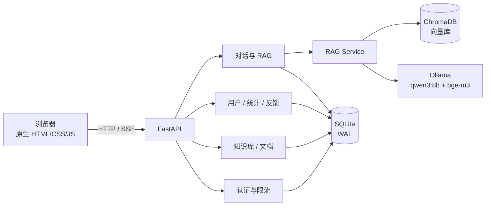
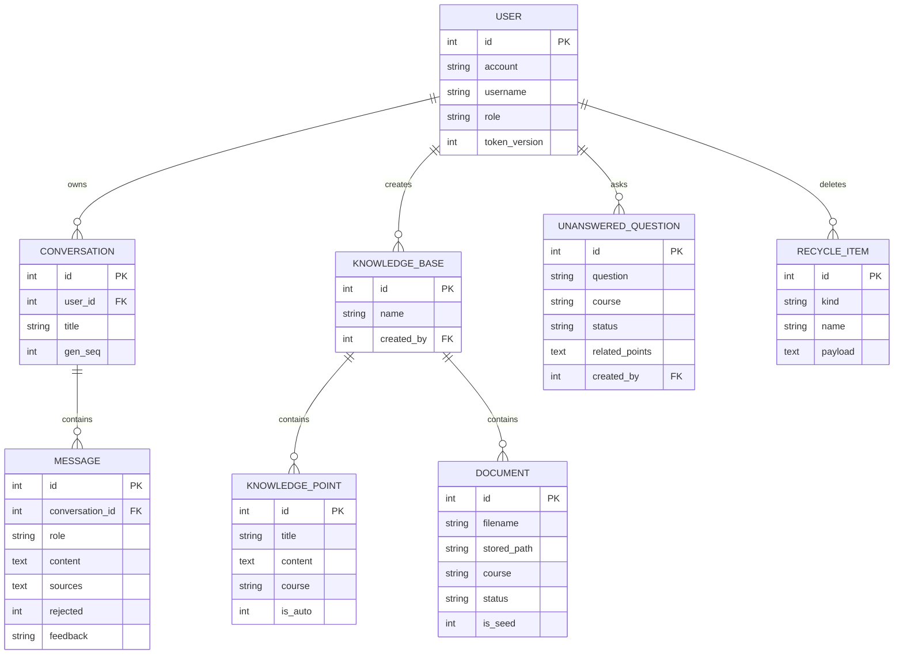
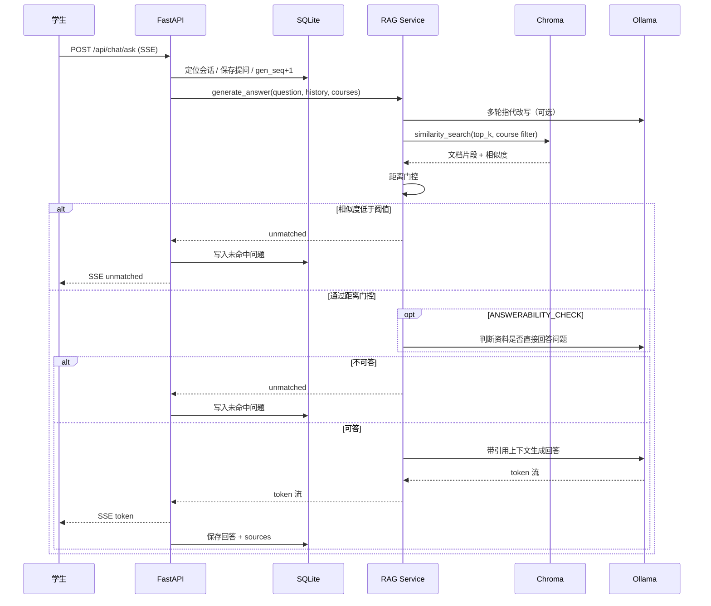

# 系统架构

## 总体架构

## 模块职责

| 模块 | 职责 |
| --- | --- |
| `backend/routers/auth.py` | 注册、登录、JWT、限流、头像、个人信息 |
| `backend/routers/chat.py` | 会话管理、SSE 问答、点赞/点踩、管理员会话查看 |
| `backend/routers/knowledge.py` | 知识库与知识点 CRUD、可见性、改名重建向量 |
| `backend/routers/documents.py` | 文档上传、解析、列表、重新解析、删除 |
| `backend/routers/unanswered.py` | 未命中问题列表、聚类、统计、补资料后重新生成 |
| `backend/routers/recycle.py` | 知识库删除快照、30 天恢复、彻底删除 |
| `backend/routers/stats.py` | 学生工作台与管理员数据概览 |
| `backend/services/rag_service.py` | 检索、门控、提示词拼装、流式生成、引用来源 |
| `backend/services/vector_store.py` | Chroma 封装、版本化写入、按课程过滤、删除 |
| `backend/static/` | 零构建前端；`views/` 下按页面拆分 |

## 数据模型

## 一次问答的时序

## 三重拒答

| 防线 | 解决的问题 | 实现位置 |
| --- | --- | --- |
| 距离门控 | 问题与课程资料明显无关 | `rag_service.generate_answer` |
| 未收录标记 | 模型自己判断资料不足 | `rag_prompts.is_unmatched_answer` |
| 可答性判定 | 资料“相近但没直接讲” | `ANSWERABILITY_CHECK` 分支 |

对应测试：`test_unmatched_gate_*`、`test_answerability_gate_blocks_similar_but_uncovered`、`test_empty_kb_short_circuits_without_llm`。

## 关键工程细节

- **SSE 流式**：`/api/chat/ask` 逐 token 推送，前端断线后可用 `regenerate` 补生成。
- **会话级并发控制**：`conversations.gen_seq` 让新提问顶掉旧流，避免两轮回答互相覆盖。
- **生成闸门**：`rag_service._llm_slots` 限制同时生成路数，排队超时返回明确错误。
- **向量版本化**：先写新版本再删旧版本，避免写入失败时把旧向量删光；检索后再做 BM25+向量混合重排。
- **回收站**：删除前落快照，恢复时重新向量化；提交失败保留 trash 原件。
