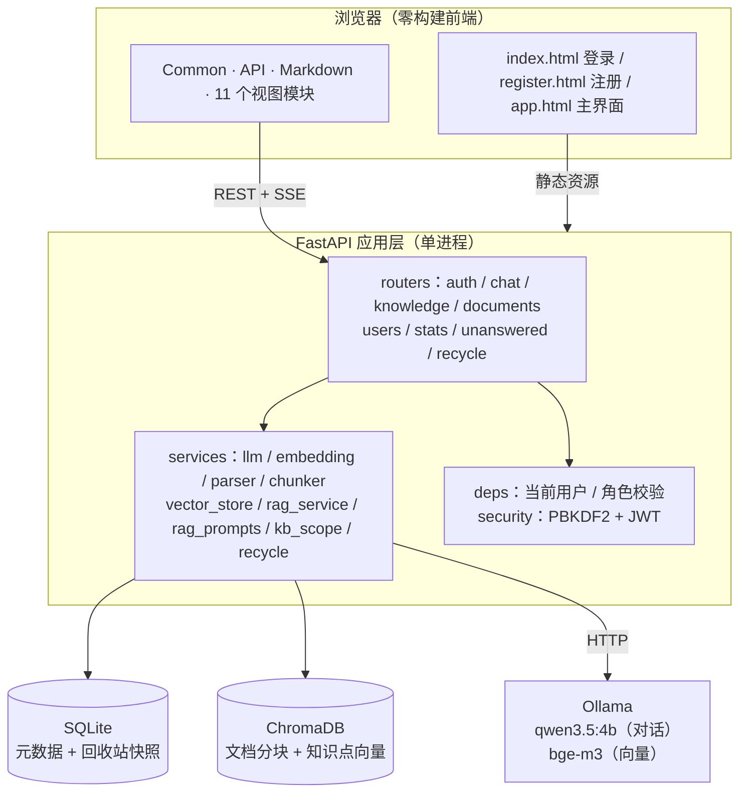
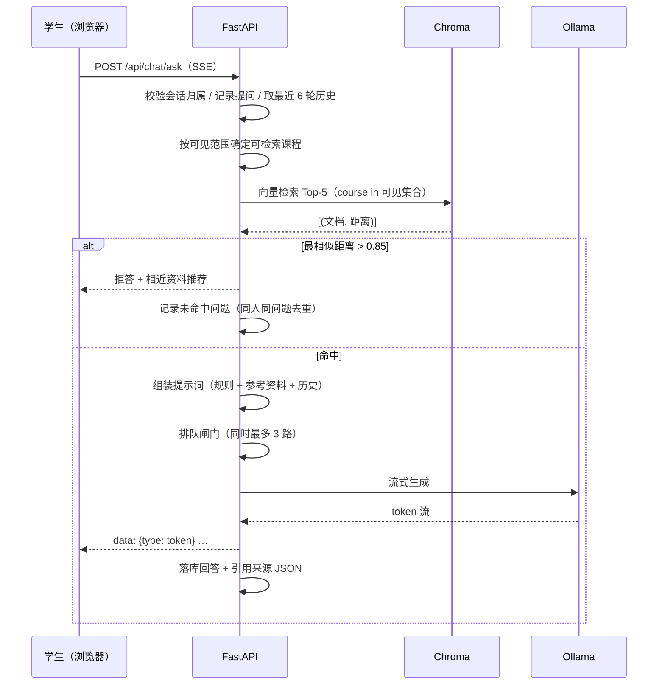
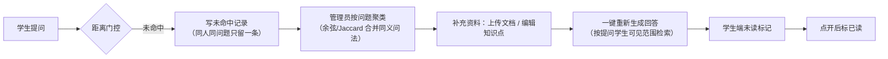
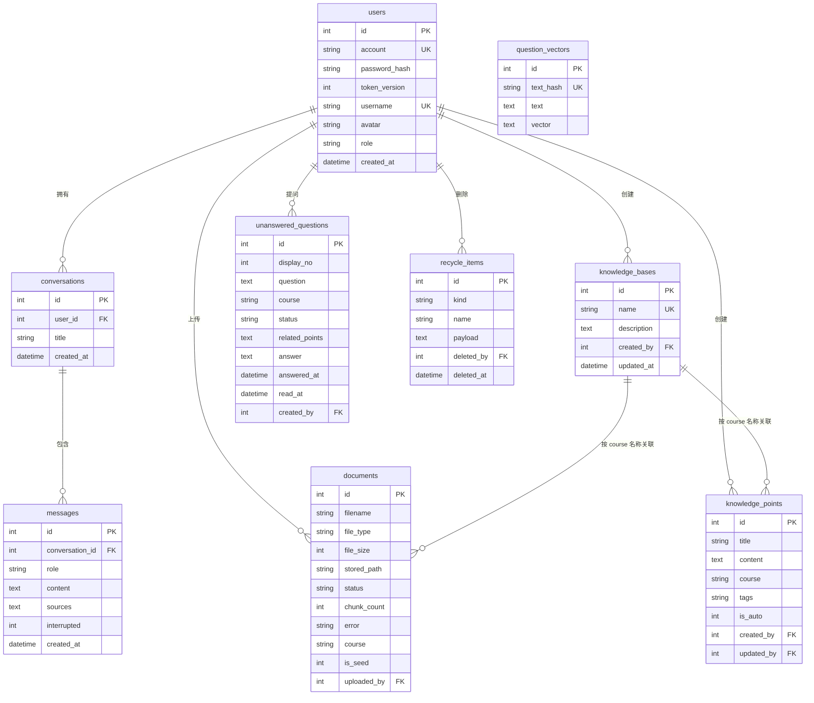

# 技术设计

课程智能问答助手（RAG）的技术设计与实现说明：项目背景、架构、技术选型、RAG 核心设计、
后端模块、数据库、接口约定、安全与部署。**快速上手请看项目根目录的 [README](../README.md)**，
逐页操作见 [使用说明](使用说明.md)，踩坑与测试见 [开发维护](开发维护.md)。

## 一、项目背景

高校课程答疑长期依赖课堂提问、课程群与教师邮箱，存在三个问题：重复问题多（同一知识点每学期
被反复追问）、答疑不及时（非工作时间的问题要等下次课）、回答口径不一致（不同助教、资料给出的
解释互相矛盾）。

本系统把课程资料作为唯一知识来源，让大模型"只回答课程内的问题"，形成
"提问—答疑—补资料—再答疑"的闭环。四条建设目标：

| 编号 | 目标 |
| --- | --- |
| G1 | 学生能就课程内容获得有出处的回答（附引用来源，可点开看原文片段） |
| G2 | 不知道就说不知道，不编造（知识库未覆盖时拒答并引导换问法） |
| G3 | 教师能看到学生问不到的问题并补齐资料（未命中问题可聚类、可一键重新生成回答） |
| G4 | 内容与用户可管理、误删可恢复（删除进回收站 30 天） |

## 二、总体架构

前后端分离部署、单体后端：浏览器只加载静态资源，业务能力全部通过 REST + SSE 接口提供；
数据层由关系库（元数据）、向量库（语义检索）和外部大模型服务组成。

| 层 | 职责 | 不做的事 |
| --- | --- | --- |
| 视图层（`backend/static`） | 渲染、交互、请求封装 | 不做权限判断、不拼业务规则 |
| 路由层（`routers`） | 参数校验、鉴权、组装响应、SSE 推送 | 不写检索算法、不直接操作向量库 |
| 服务层（`services`） | 检索、提示词、分块、向量化、回收站、可见性 | 不关心 HTTP 状态码 |
| 数据层 | SQLite（结构化）+ Chroma（语义） | — |

## 三、技术选型

| 技术 | 用途 | 选型理由 |
| --- | --- | --- |
| FastAPI | Web 框架 | 原生 async + SSE 流式；自动生成 OpenAPI 文档 |
| SQLAlchemy 2.x | ORM | 类型化 `Mapped` 声明；迁移用增量 `ALTER TABLE` 兜底 |
| SQLite（WAL） | 元数据库 | 单机零部署；WAL + `busy_timeout` 让读不阻塞写 |
| ChromaDB | 向量库 | 嵌入式持久化，无需单独服务；支持 metadata 过滤（按课程隔离） |
| LangChain（core/chroma/ollama） | 模型与检索胶水 | 统一 Ollama 与 OpenAI 兼容接口；切换模型只改 `.env` |
| Ollama | 本地推理 | 数据不出口；4B 模型 16G 内存可跑 |
| PyJWT + hashlib | 认证 | 标准库 PBKDF2 免 bcrypt 编译依赖 |
| 原生 HTML/CSS/JS | 前端 | 零构建、断网可用 |

## 四、用户角色与权限

两类角色，登录后按角色装配不同的侧边栏与接口权限。

| 能力 | 学生 | 管理员 |
| --- | --- | --- |
| 注册 / 登录 / 改资料 / 改密码 | ✅ | ✅（管理员由系统预置，不开放注册） |
| 智能问答（检索范围） | 仅"管理员发布的 + 自己创建的"知识库 | 全部知识库 |
| 新建知识库 / 维护知识点 | ✅（自己的库） | ✅（全部） |
| 上传文档 | ✅（自己的库） | ✅（全部） |
| 删除知识库 | 仅自己的库 | 全部，且进回收站 |
| 查看未命中反馈 | 只看自己的 | 全部，可聚类、可重新生成回答 |
| 对话历史 | 只看自己的 | 全部 |
| 用户管理 / 回收站 / 数据概览 | ❌ | ✅ |

权限规则集中在 `backend/services/kb_scope.py`（可见性）与 `backend/deps.py`
（`get_current_user` / `require_role`），不在各接口里散落判断。

## 五、RAG 核心设计

### 问答流程

### 关键参数

| 参数 | 默认值 | 作用 | 调大/调小的效果 |
| --- | --- | --- | --- |
| `TOP_K` | 5 | 检索条数 | 大 → 召回全但噪声多、提示词变长 |
| `UNMATCHED_DISTANCE` | 0.85 | 拒答阈值（L2 距离） | 小 → 更严格，更多拒答 |
| `CHUNK_SIZE` / `CHUNK_OVERLAP` | 800 / 120 | 分块长度与重叠 | 大 → 上下文完整但检索粒度粗 |
| `HISTORY_LIMIT` / `HISTORY_CHAR_BUDGET` | 6 轮 / 6000 字 | 多轮上下文 | 大 → 追问连贯但可能挤爆 8K 窗口 |
| `ANSWERABILITY_CHECK` | false | 命中后再让模型判"资料能否直接回答" | 开 → 更少幻觉，每次多一次模型调用 |
| `LLM_TIMEOUT` | 180 s | 单轮生成上限 | — |
| 会话聚类阈值 | 余弦 0.78 / Jaccard 0.55 | 同义问题合并 | 小 → 合并更激进 |

> 阈值不是拍脑袋：`.env` 注释记录了实测分布——库里有答案 0.46–0.78，库里没有但话题沾边
> 0.91–1.05，完全无关 1.19–1.21，0.85 落在空档。换向量模型后必须重新标定。

### 三道拒答防线

| 防线 | 判据 | 防的问题 |
| --- | --- | --- |
| ① 距离门控 | 最相似距离 > 0.85 | 知识库压根没这个话题 |
| ② 模型标记 | 回答前 40 字出现"【知识库未收录】"等特征短语 | 模型自己判断资料不支撑 |
| ③ 可答性判定（可选） | 窄任务模型只回"有/没有" | 资料看似相关、实际讲的不是这个点 |

拒答时不只丢一句"不知道"：推荐 3 条相近资料标题引导换问法，并写入未命中反馈。

### 反馈闭环

教师的每一次补资料都有明确来源（学生真实问不到的问题），而不是凭感觉猜。

### 并发与失败设计

单机 4B 模型一次只能吐一路 token，因此：

| 机制 | 实现 | 解决的问题 |
| --- | --- | --- |
| 并发闸门 | 每事件循环一个 `Semaphore(3)` | 无限并发时所有请求一起撞 180 s 超时 |
| 排队心跳 | 每 10 s 发 `ping` 事件 | 前端空闲超时会把排队中的请求误杀 |
| 排队上限 | 120 s | 明确回"当前提问人数较多"，不让用户干等 |
| 序号顶替 | 会话级 `_gen_seq` | 同一会话连发两次，旧回答不落库、不占模型 |
| 失败不落库 | 超时/报错/空回答 → 占位提示 | 避免把半截回答当正式答案喂给下一轮历史 |
| 单进程约束 | `run.py` 固定单 worker | 序号是进程内状态，多 worker 会退化成两条答案 |

## 六、后端模块

### 路由模块

| 模块 | 接口数 | 职责 |
| --- | --- | --- |
| `auth.py` | 6 | 注册、登录、当前用户、改密、改资料、头像上传 |
| `chat.py` | 12 | 会话 CRUD、消息列表、SSE 问答、回答评价、学生反馈、管理员会话视图 |
| `knowledge.py` | 9 | 知识库与知识点增删改查（分页 + 搜索 + 可见性） |
| `documents.py` | 5 | 上传（后台解析）、列表、详情（分块预览）、重新解析、删除 |
| `users.py` | 5 | 管理员用户管理（列表/选项/新增/修改/删除） |
| `stats.py` | 3 | 学生个人统计、管理员全局统计（含 7 日趋势、质量指标、热门问题）、文档引用排行 |
| `unanswered.py` | 7 | 未命中问题列表、聚类、统计、重新生成回答、状态、已读、删除 |
| `recycle.py` | 3 | 回收站列表、恢复、彻底删除 |

### 服务模块

| 模块 | 职责 | 关键点 |
| --- | --- | --- |
| `llm_service.py` | 按配置返回 Chat 模型 | 显式关闭 qwen3.5 的思考（`reasoning=False`），否则正文被思考过程挤空 |
| `embedding_service.py` | 返回嵌入模型 | 与对话模型可用不同来源（`EMBEDDING_PROVIDER`） |
| `document_parser.py` | PDF/TXT/MD/CSV 取文本 | 只取文本，不做 OCR |
| `chunker.py` | 递归字符分块，兼顾中文标点 | 分隔符含 `。！？；`；**延迟导入**分词器，避免启动时拉起 transformers |
| `vector_store.py` | 向量增删查 | 文档分块与知识点同集合；检索按 `course` 元数据过滤；结果按来源去重 |
| `rag_prompts.py` | 提示词与判定词表 | 纯常量 + 纯函数，调提示词不用翻生成逻辑 |
| `rag_service.py` | 检索 → 门控 → 生成 → 拒答 | 并发闸门、超时、序号顶替 |
| `kb_scope.py` | 可见性与写权限 | 学生"看得见 ≠ 写得进"：公共库只读 |
| `recycle.py` | 删除快照与过期清理 | 源文件移入 `data/trash/<id>/`，恢复时搬回 |

依赖方向单向：`routers → services → (models, config, database)`，服务之间不互相调用成环。

## 七、数据库设计

### ER 图

### 表清单与设计要点

| 表 | 设计要点 |
| --- | --- |
| `users` | `account`、`username` 唯一；`role` 建索引；`token_version` 实现改密即踢下线 |
| `conversations` | `user_id` 外键 CASCADE，删用户即删会话；两个遗留列保留只为不破坏老库 |
| `messages` | `sources` 存引用 JSON；`interrupted` 区分完整回答与中断半截 |
| `knowledge_bases` | 按课程组织；知识点与文档用 `course` 名称关联（不设外键，改名需同步） |
| `knowledge_points` | `is_auto` 标记"文档自动生成"，重建向量时跳过，避免与分块重复 |
| `documents` | `status` 三态（processing/ready/failed）；`is_seed` 标记演示数据 |
| `unanswered_questions` | `display_no` 是展示编号，删除后重排，不依赖主键 |
| `question_vectors` | 问题向量缓存，`text_hash` 唯一，聚类时复用 |
| `recycle_items` | `payload` 存库信息+知识点正文 JSON，源文件在 `data/trash/<id>/` |

SQLite 默认不校验外键，连接时显式 `PRAGMA foreign_keys=ON`；`journal_mode=WAL` +
`busy_timeout=5000` 让读写并发不互相阻塞。增量迁移在 `init_db()` 每次启动按
`PRAGMA table_info` 比对补列，避免重新建库丢数据。

## 八、接口约定

| 项 | 约定 |
| --- | --- |
| 鉴权 | `Authorization: Bearer <JWT>`；角色接口再用 `require_role` 校验 |
| 分页 | 查询参数 `limit` / `offset`，响应含 `total` 与 `items` |
| 搜索 | 统一 `q` 参数，服务端 `LIKE` 并转义 `%_`（`services/like.py`） |
| 错误 | HTTP 状态码 + `{"detail": "中文说明"}`；401 令牌失效、403 越权、404 不存在 |
| 流式 | `POST /api/chat/ask` 返回 `text/event-stream` |

完整接口清单见启动后的 `/docs`（OpenAPI 自动生成）。SSE 事件类型：

| type | 载荷 | 前端处理 |
| --- | --- | --- |
| `ping` | — | 重置空闲计时，不渲染 |
| `token` | `content` | 追加到当前气泡 |
| `sources` | `sources[]` | 渲染引用卡片（标题/课程/片段） |
| `unmatched` | `recommended[]` | 展示"没收录 + 相近资料" |
| `saved` | `message_id` | 标记本轮结束，解除输入禁用 |
| `error` | `message` | 停止转圈，提示原因（排队未排上/超时） |
| `done` | — | 关闭连接 |

## 九、安全设计

| 面 | 措施 | 位置 |
| --- | --- | --- |
| 密码 | PBKDF2-SHA256 + 16 字节随机盐，10 万次迭代，恒定时间比较 | `security.py` |
| 令牌 | HS256 JWT，含 `ver`；改密/降权自增 `token_version` 即全端失效 | `security.py` / `auth.py` |
| 密钥 | `JWT_SECRET` 缺失或为占位值直接拒绝启动 | `config.py` |
| 越权 | 接口级 `require_role`；检索按可见课程过滤；"看得见 ≠ 写得进" | `deps.py` / `kb_scope.py` |
| 限流 | 登录按账号+IP、注册按 IP，内存滑窗 + 定期清理 | `auth.py` |
| CORS | 只放行 `localhost` / `127.0.0.1` 任意端口 | `main.py` |
| 上传 | 类型白名单 + 20 MB 上限 + 头像按文件头校验 | `documents.py` / `auth.py` |
| 默认管理员 | 本机监听仅告警；放开到 `0.0.0.0` 且密码未改则拒绝启动 | `main.py` |
| XSS | 前端先转义后渲染 + 危险协议拦截 | `markdown.js` |

## 十、部署与运行

| 项 | 说明 |
| --- | --- |
| 进程模型 | 单进程 uvicorn（序号顶替依赖进程内状态），`python run.py` 一键启动 |
| 数据目录 | `data/app.db`（SQLite）、`data/chroma/`（向量）、`data/uploads/`、`data/trash/` |
| 冷启动 | 实测 13–16 s（冷启动 15.7 s、热启动 13.2 s，模型由 Ollama 侧加载，应用只做连接） |
| 模型准备 | `ollama pull qwen3.5:4b` + `ollama pull bge-m3`；也可切 OpenAI 兼容 API |
| 配置 | `.env`（见 `.env.example`），含模型、阈值、分块、超时等 |
| 工程质量 | `pyproject.toml` 配 ruff（120 列、E/F/I）；`pytest` 29 个用例（含 2 个 node 前端回归） |
